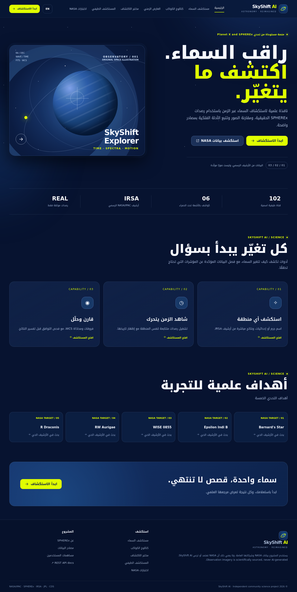

# SkyShift AI

**Watch the sky. Find what changes.** An independent, Arabic-first scientific web application for exploring NASA SPHEREx observations via the official IPAC/IRSA archive, with real astronomy resolvers and an observational provenance trail.



## Honest final-source status — v1.0.0 (2026-11-14)

The app server and browser UI run locally. **74 automated tests passed** in the updated build, including yearly metadata selection and signed-difference rendering. Actual NASA SIA2 / TAP / Horizons live calls could not be verified here because the build runtime has no external DNS access. The source code executes those live requests in an internet-enabled deployment; it does not substitute sample images or success responses. FITS previews and reprojection require the optional scientific dependencies (not installed in the limited build runtime). No live NASA detections are claimed.

## Final improvements over v0.2.4

- **HTTP 422 recovery:** when IRSA refuses an on-prem FITS cutout, the service tries a smaller cutout at exactly the same target coordinates and records requested vs. actual FOV. No fallback to a different object's position.
- **Annual pair recovery:** the backend selects only previously authenticated SIA records, tests alternative exposures from the requested 2025/2026 years, and reports failed attempts. A missing year or unusable image remains unavailable—never simulated.
- **Safe chronological difference:** later exposure minus earlier exposure, regardless of request ordering. A rough wavelength compatibility check from WAVE-TAB must pass before computing differences; all differences remain exploratory, not scientifically confirmed variability.
- **Official spectral WCS handling:** disabled spatial SIP on the alternative detector spectral WCS as instructed by IRSA; approximate wavelengths are sampled at the true sky target and normalized to micrometers.
- **QA:** 74 Python regression/contract tests and a headless Chromium workflow with deliberately *mocked* network responses, covering 422 messaging, annual side-by-side, difference UI, bilingual control and 390px layout. See `reports/FINAL_QA.md`.

**The live NASA integration was demonstrated previously by a user-provided Windows terminal log for some targets, but this final patch itself has not been run against live NASA here. A science-grade SPHEREx detection or annual motion measurement is not verified.**

## Quick start

Recommended: Python 3.11–3.12.

```bash
python3 -m venv .venv
source .venv/bin/activate  # Windows: .venv\Scripts\activate
python -m pip install -r requirements-science.txt
uvicorn backend.app.main:app --host 127.0.0.1 --port 8000
```

Open http://127.0.0.1:8000. API documentation: http://127.0.0.1:8000/api/docs.

For a minimal interface + metadata-only development environment install `requirements.txt`, but note that FITS rendering requires `requirements-science.txt`.

Windows: double-click `RUN_WINDOWS.bat`. Docker: `docker compose up --build`.

## What's new — v0.2.4 annual comparisons

Choose two *available* calendar years in the observation results and click **Compare selected years**. The interface loads one authentic FITS record from each year, shows two dated images, offers a blink mode, and an optional WCS-based **Calculate difference** action. The signed difference uses **red for positive (later minus earlier)** and **blue for negative**, rather than hiding negative pixels. These colors are visual cues only, not detection significance. Individual preview images are auto-stretched separately; do not use their apparent brightness alone to claim variability. Per-pixel wavelength compatibility, calibration, image registration and PSF differences still limit interpretation.

SPHEREx began collecting observations in 2025, so this version does **not** claim to display SPHEREx epochs for 2010–2024. Historical comparison would require a separate WISE/NEOWISE or similar dataset, with careful wavelength and astrometric treatment. Particularly for high proper-motion objects such as WISE 0855, static catalog coordinates and variable spectral wavelengths require caution. Comparison results must be verified with genuine NASA files in a networked environment.

## Core behavior

- Names: JPL Horizons for dated solar-system ephemerides; NASA Exoplanet Archive for named exoplanet **host systems**; CDS Sesame for named stars and galaxies. Manual RA/Dec accepts decimal degrees and sexagesimal coordinates.
- Images: IVOA SIA2 `COLLECTION=spherex_dr1|spherex_qr3` (optionally `_deep`), `POS=CIRCLE ...`, using the official IRSA FITS `access_url` and official IBE cutout query. Cache keys incorporate record, release, location, FOV, date, detector and wavelength metadata.
- Time explorer: observations are sampled across available observing years rather than only taking the earliest consecutive exposures. The annual comparison can load one authentic FITS image per year, display them side by side, blink between them, and compute a WCS-aligned difference only when per-pixel spectral checks permit. Missing epochs are not simulated.
- Science: reads IMAGE, FLAGS and VARIANCE, Astropy WCS/WCS-WAVE, and Reproject for alignment. Wavelength validation is approximate at the actual target pixel, not a complete all-pixel spectral cross-calibration.
- Catalog: uses actual NASA TAP `pscomppars` data, not embedded planet records. The Solar System list only maps names to JPL body IDs.
- User notes: stored as candidates requiring verification, not claims of discovery.
- UI: responsive Arabic RTL default; English toggle; English astronomical object names and LTR numeric coordinates.

## Main routes

| User page | Path | Backing functionality |
|---|---|---|
| Home | `/` | Original graphical hero, references and entry points |
| Sky Explorer | `/explore` | Object resolution, IRSA records, FITS preview, timeline |
| Planet Catalog | `/catalog` | NASA Exoplanet Archive TAP + solar body lookup |
| Time Explorer | `/time` | Time controls on the same live observation workspace |
| Discovery Lab | `/lab` | WCS difference/stack, preliminary aperture photometry, candidate notes |
| Spectrum Explorer | `/spectrum` | Detector bands and actual SIA record wavelength metadata |
| NASA Challenge Validation | `/validation` | Five independent targets; unverified status, launch searches |
| User Observations | `/observations` | Locally saved unverified notes |
| About SPHEREx | `/about` | Mission context and caveats |
| Data Sources | `/sources` | Official links and attribution |

## Verification

```bash
python -m pytest -q
python scripts/validate_targets.py --live
```

Do not convert untested remote services into PASS marks. See `reports/VALIDATION.md` for required-target status, and `docs/SCIENTIFIC_METHOD.md` for exact scientific limitations. The frontend intentionally uses framework-free ES modules rather than React/Vite, reducing installation and enabling a functional browser deployment without an npm build step. Migration to React/TypeScript is a possible future engineering step, but **not** a completed feature.

## Deployment

`docker-compose.yml` builds the scientific dependencies inside Python 3.12 and serves FastAPI and the static web UI on port 8000. For public use, configure HTTPS and a reverse proxy; monitor upstream quotas and authentication for annotations. See `docs/DEPLOYMENT.md`.

## Attribution

NASA/IPAC IRSA SPHEREx DR1 spectral images DOI **10.26131/IRSA678**, plus Exoplanet Archive, JPL Horizons and CDS. See `docs/SOURCES.md` for links. NASA does not endorse this project.

## CDS name-resolution recovery (Nov 14, 2026)

This patch uses the documented Sesame `/-oxp?Object_Name` request format, safely follows bounded redirects to allow-listed HTTPS astronomy endpoints and falls back from IDIA to Harvard to CDS. The common alias WISE 0855 is expanded to the verified SIMBAD designation. Scientific caveat: very high-proper-motion sources need observation-epoch coordinate propagation; Sesame coordinates alone are not guaranteed to track the source in 2026. No locally fabricated target coordinates are substituted if all mirrors fail. CDS service advisory: https://cds.unistra.fr/


### Version 0.2.3: archive diagnostics
The explorer now distinguishes archive-empty results, user filters, unsupported download URLs, and failed IRSA queries. The DR1 all-sky cube is a separate dataset and is not searched as a spectral-image collection.

## v0.2.3 — fix FITS frame build HTTP 500

A user log showed valid upstream CDS and IRSA HTTP 200 responses (with a transient, successfully retried HTTP 503), followed by `TypeError: type numpy.ndarray doesn't define __round__ method` in `/api/spherex/frames/build`. Scalar WCS pixel coordinates are now validated and normalized from NumPy scalars or single-element arrays to finite Python floats before bounds checking or rounding. More than one pixel coordinate is rejected to avoid guessing the target position. SIP-distortion warnings from the FITS header are still retained for scientific review. Tests cover the original failure without using fabricated observations in the product.
